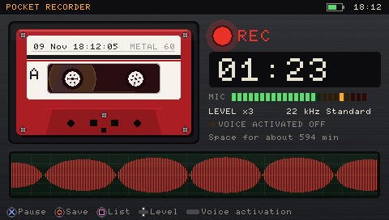
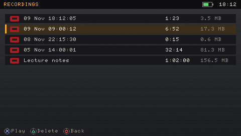
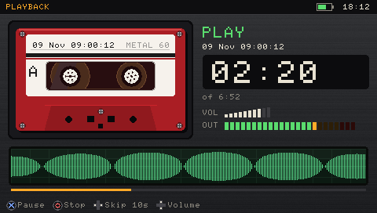

# Pocket Recorder for PSP

A retro dictaphone for the PSP-3000's built-in microphone (or a headset mic). Recordings are saved as WAV files in `ms0:/MUSIC/Recordings`, so they also show up as a tape in [Cassette Deck](https://github.com/ar3misByte/psp-cassette-deck).

> Vibe coded: the whole app was built by describing it to Claude (Anthropic's AI) in plain English. I didn't write the C code by hand.

| Recording | Recordings | Playback |
|---|---|---|
|  |  |  |

## Features
- Record, pause and resume, with a live level meter and scrolling waveform
- Quality: 11 kHz (voice), 22 kHz, 44 kHz
- Mic level x1 to x12
- Voice activation: pauses on silence, continues when you speak
- Recordings list with playback, 10-second skip and delete
- Shows the recording time left on the Memory Stick
- Crash-safe: the WAV header is updated every 10 s, and quitting saves first

## Install
Copy `release/PSP/GAME/RECORDER` to `ms0:/PSP/GAME/` and launch **Pocket Recorder**.

## Controls
X record/pause · O stop and save · Square recordings · Up/Down mic level · START quality · SELECT voice activation

## Build
Needs the [pspdev](https://github.com/pspdev/pspdev) toolchain: `make`.
`tools/rectest.c` runs the recording code against a fake microphone and checks every sample lands in the WAV file in order.
